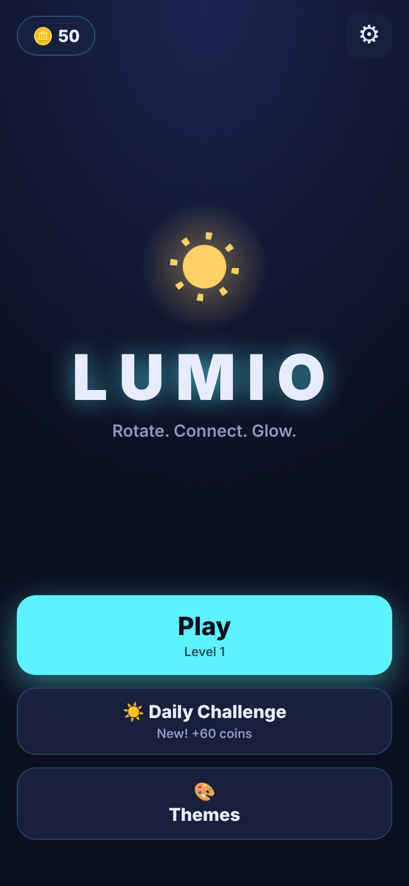
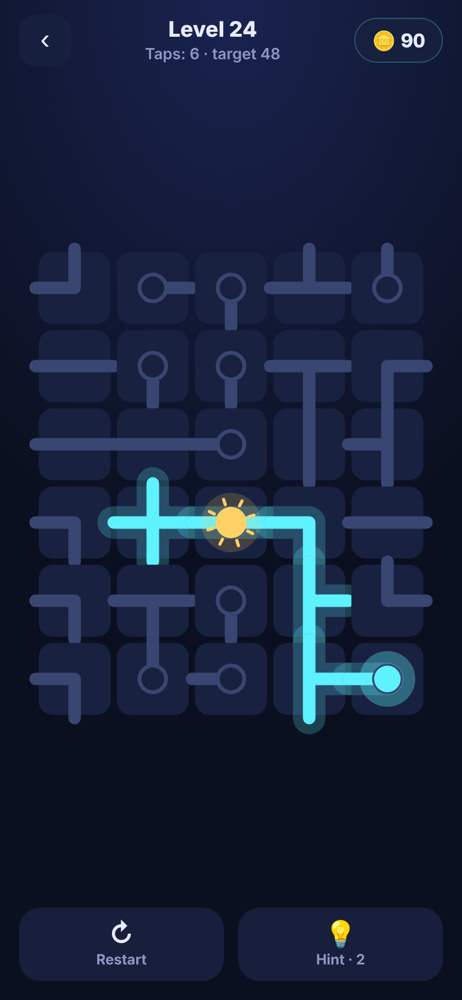
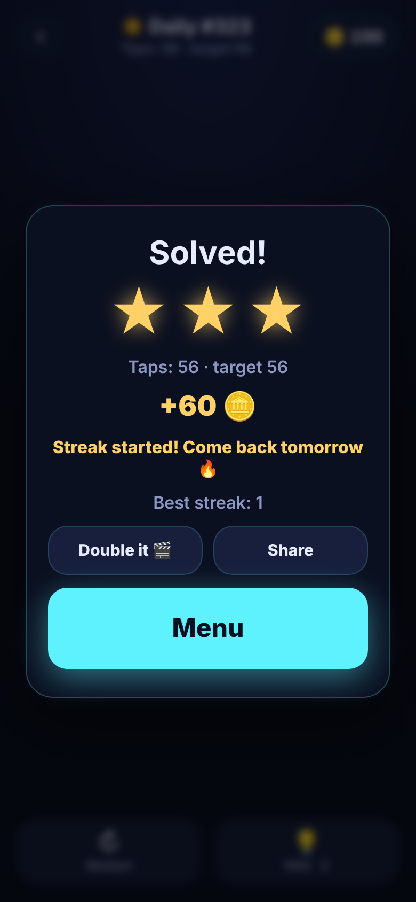

# 🔆 LUMIO: Ruota. Connetti. Illumina.

Rompicapo minimalista per **Android e iOS**. Tocchi le tessere per ruotarle e colleghi il sole a tutte le lampadine. Una partita dura 30–90 secondi, i livelli sono infiniti e c'è una sfida al giorno.

Il gioco è in HTML5/JavaScript puro, senza framework né asset esterni (anche i suoni sono sintetizzati). È impacchettato come app nativa con [Capacitor](https://capacitorjs.com).

<p align="center">
  
  
  
</p>

## Cosa c'è dentro

| Meccanica | Perché serve |
|---|---|
| **Livelli infiniti generati proceduralmente** (albero di copertura casuale) | Ogni livello è sempre risolvibile e uguale per tutti i giocatori (seed fisso). Non va disegnato a mano. |
| **Curva di difficoltà a dente di sega**: la griglia cresce da 3×3 a 8×10, un livello "relax" 🌙 ogni 5 e un "boss" ⚡ ogni 10 | Alterna tensione e sollievo, così il giocatore resta nel "flow". |
| **Stelle** in base ai tocchi rispetto all'obiettivo (par) | Spinge a rigiocare e a cercare la soluzione ottimale. |
| **Sfida del giorno** con **serie (streak)** e premi crescenti fino a 7 giorni | È il motore principale di retention D1/D7. |
| **Condividi** il risultato (stile Wordle: "Lumio Sfida #323 · 56 tocchi ⭐⭐⭐") | Porta crescita organica. |
| **Monete** → suggerimenti e temi (Aurora, Ember, Mint, Neon) | Economia interna e base per la monetizzazione. |
| **Suggerimenti**: 3 gratis, poi 30 monete oppure un video premio | Aiuta chi è bloccato e genera entrate pubblicitarie. |
| **Raddoppia monete** guardando un video | Il formato pubblicitario meno invasivo e più redditizio. |
| **Interstitial** ogni 4 livelli, solo dopo il livello 8 | I primi minuti restano puliti, che sono quelli decisivi. |
| **Feedback**: vibrazione, suoni che salgono di tono man mano che ti avvicini alla soluzione, animazione a onda e particelle alla vittoria | Rende ogni tocco soddisfacente. |
| Italiano/inglese automatico, tasto indietro Android, safe-area iPhone, salvataggio locale | Le basi per uscire su tutti gli store. |

## Provarlo subito (browser)

```bash
cd lumio
npm run serve        # apri http://localhost:8080 (meglio con la vista mobile di Chrome DevTools)
```

Test:

```bash
npm test             # generatore: 360 puzzle verificati (risolvibili, deterministici)
npm run e2e          # gioca davvero nel browser (richiede Playwright)
```

## Build per Android e iOS

Ti servono **Android Studio** per Android e un **Mac con Xcode** per iOS.

```bash
cd lumio
npm install
npm run android      # crea /android, sincronizza e apre Android Studio
npm run ios          # crea /ios, sincronizza e apre Xcode (solo macOS)
```

Dopo ogni modifica in `www/` lancia `npx cap sync`.

### ⚠️ Obbligatorio prima di avviare l'app: ID AdMob

Il plugin AdMob fa **crashare l'app all'avvio** se manca l'App ID. Nella fase di sviluppo usa gli ID di test di Google:

**Android**: `android/app/src/main/AndroidManifest.xml`, dentro `<application>`:
```xml
<meta-data android:name="com.google.android.gms.ads.APPLICATION_ID"
           android:value="ca-app-pub-3940256099942544~3347511713"/>
```

**iOS**: `ios/App/App/Info.plist`:
```xml
<key>GADApplicationIdentifier</key>
<string>ca-app-pub-3940256099942544~1458002511</string>
```

Prima della pubblicazione:
1. Crea l'app su [AdMob](https://admob.google.com) e sostituisci questi ID con i tuoi.
2. Metti le tue unità "rewarded" e "interstitial" in `www/js/platform.js` (`AD_UNITS`).
3. In `platform.js` cambia `initializeForTesting: true` in `false`.
4. Configura il consenso GDPR (UMP, obbligatorio in UE) e su iOS l'App Tracking Transparency. Il plugin AdMob li supporta entrambi.

### Icone e splash

```bash
npm i -D @capacitor/assets
# metti un PNG 1024x1024 in assets/icon.png (puoi esportarlo da www/icons/icon.svg)
npx capacitor-assets generate
```

Cambia anche `appId` in `capacitor.config.json` (`com.lumio.puzzle`) con un identificativo tuo.

## Struttura

```
lumio/
├── www/                    # il gioco (è la cartella che Capacitor impacchetta)
│   ├── index.html
│   ├── css/style.css
│   └── js/
│       ├── generator.js    # generazione puzzle + curva di difficoltà
│       ├── board.js        # rendering canvas, input, animazioni, vittoria
│       ├── main.js         # schermate, economia, streak, flusso di gioco
│       ├── platform.js     # haptics, audio, share, AdMob (con fallback web)
│       ├── themes.js       # temi sbloccabili
│       ├── i18n.js         # IT / EN
│       └── storage.js      # salvataggio locale
├── tests/                  # test unitari + end-to-end
├── capacitor.config.json
└── package.json
```

## Detto onestamente: come aumentare le probabilità di successo

Nessuno può garantire che un gioco arrivi in cima alle classifiche o ti renda ricco. Il codice è il punto di partenza; il resto dipende da distribuzione, dati e iterazione. I prossimi passi che contano di più:

1. **Verifica il nome**: controlla che "Lumio" sia libero sugli store e come marchio. In caso contrario basta cambiare `appName`, il titolo e i testi.
2. **Soft launch** in 1–2 paesi economici (es. Filippine, Canada) prima del lancio globale. Misura **retention D1 (>40%)**, **D7 (>15%)** e durata della sessione.
3. **Analytics**: aggiungi Firebase Analytics o GameAnalytics. Gli eventi utili sono livello iniziato, completato e abbandonato, suggerimento usato, annuncio visto. In questo modo vedi in quale livello i giocatori abbandonano e ritocchi la curva in `levelConfig()`.
4. **Acquisti in-app**: "Rimuovi pubblicità" (il flag `noAds` è già nel salvataggio) e pacchetti di monete con `@capgo/native-purchases` o RevenueCat. Tipicamente rendono più degli annunci per i giocatori più fedeli.
5. **Notifiche push locali** ("La tua serie di 5 giorni sta per spezzarsi 🔥") con `@capacitor/local-notifications`. Sono la leva di retention più efficace dopo la daily.
6. **Marketing**: i rompicapo rilassanti funzionano molto bene su TikTok e Reels (video di 10 secondi in cui tutta la griglia si illumina). Testa i creativi prima di pagare l'acquisizione utenti.
7. **ASO**: screenshot chiari, parole chiave "puzzle, relax, logic, brain" e un video di anteprima di 15 secondi.

Idee per gli aggiornamenti: classifiche (Game Center / Play Games), eventi stagionali con temi a tempo, modalità a tempo, tessere speciali (bloccate, a ponte, a colori multipli) per i livelli avanzati.
